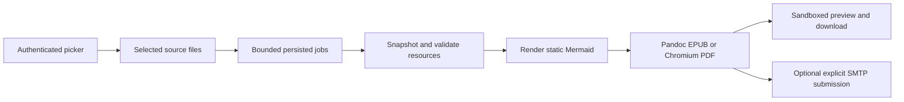

# Handoff

Read `AGENTS.md`, `docs/STATUS.md`, latest `docs/PROGRESS.md`,
`docs/DECISIONS.md`, and `docs/OPERATIONS.md` before changing code.

## Objective and user preferences

Windows-first, later macOS-compatible local Markdown publisher for a first-gen
Kindle Scribe: select locally synced iCloud/local files, render optional Mermaid,
preview/export EPUB/PDF, download or submit to fixed configured Kindle email.
Reading is primary; device-side notes are optional. Bidirectional note sync is
outside scope. Keep all progress/handoff in Markdown, Mermaid where useful, and
maintain setup/config/start/open/status/stop/reset/doctor/test scripts together.

## Current implementation

The publishing service now exists. TypeScript builds to ignored `dist/`; plain
browser UI lives in `public/` and `src/ui.ts`. Production conversion/library/job/
SMTP/HTTP code is in `src/`, separate from the retained disposable `spike/`.
The user's actual source path stays in ignored `config.local.json`, not these docs.



Normal `start` builds/starts the persistent service, waits for HTTP readiness,
and reports URL/log/token-file paths without token values. `start -Open` and
`open.ps1` open an authenticated browser using a cleared URL fragment. `start
-Proof` or legacy `start -Files ...` is the finite experiment. Existing `proof.ps1`
remains for comparison. Windows launch uses a hidden independent process because
PowerShell 5 otherwise kept captured output handles attached to the service.

Default listener is localhost port 8787. Token is in ignored `.state/access-token`;
browser sessions are HttpOnly/SameSite. LAN binding requires explicit config and
trusted-network use. Phone-access setup now binds this host to `0.0.0.0:8787`
in ignored local configuration. No firewall changes or public hosting were performed.
Existing Node firewall allow rules were found. LAN-IP health and picker returned
200 from this laptop; access from the phone remains to be checked. Check
live status before build/tests/reset; stop the service first for those operations.
SMTP is disabled; no real recipient/credentials were supplied. Configure through
script/ignored JSON; password values come only from a named environment variable.
No private iCloud documents were converted and no real email was sent in tests.

## Commands

```powershell
.\scripts\setup.ps1                  # Existing configured host; new host can pass -SourceDir
.\scripts\start.ps1 -Open
.\scripts\status.ps1
.\scripts\open.ps1
.\scripts\stop.ps1
.\scripts\doctor.ps1
.\scripts\test.ps1
.\scripts\reset.ps1 -WhatIf
```

Read operations before reset. Default reset removes all output/history/snapshots,
logs/token/runtime state; keeps source/config/tools/packages/build. Dependency
reset additionally clears `node_modules` and `dist`, then setup rebuilds. Setup,
build/reset refuse an active service, including directly launched instances.
No arbitrary persisted PID is killed. Generated roots/subfolders are validated
canonically and source overlap is refused before writes/deletion.

## Verification on 2026-11-04

- Latest TypeScript build and **57/57 full tests passed** after desktop uploads.
- Desktop reader/file browser are side by side; phone panels stack. Read source
  as inert text, then Convert this document or selected batch. File/drop uploads
  and folder imports preserve raster assets under managed `output/uploads`.
  Explicit job source kind confines conversion resources to each upload batch.
- Uploads: 10 documents, 100 images, 30 MiB per batch; 2 MiB Markdown/10 MiB image;
  100 retained batches. Reset removes uploaded copies with output, never originals.
  Standalone upload use without sourceDir is verified. Desktop/mobile screenshots
  inspected; independent review found no critical/important issues.
- Earlier `codex/mail-to-kindle` work: validated one/multiple recipient config
  and scripts implemented; actual address saved only in ignored local config.
  Mail UI is pending user workflow choice. iOS mailto cannot attach files, native
  Web Share needs HTTPS and lacks a recipient field, .eml is not a reliable
  cross-client editable draft. A follow-up question is pending in this chat.
- Desktop sender investigation: no Send to Kindle installation detected on the
  current host. No documented official unattended CLI/API found; current binary
  launch behavior unverified. See `docs/delivery-options.md`. SMTP remains the
  implemented unattended submission path, pending real provider configuration.
- Delivery choice is deferred by the user. Sleep investigation found AC idle sleep
  set to Never under High performance; battery timeout 10 minutes. No power settings
  changed; active power requests could not be read without elevation. Proposed
  quiet-listener/30-minute activity-lease policy is in `docs/power-management.md`;
  not implemented. Avoid treating browser polling as deliberate activity.
- Browser sessions persist as HttpOnly/SameSite cookies for a rolling year, backed
  by HMAC credential hashes in ignored `.state/device-sessions.json`. Reuse current
  credentials on `-Open`; signout revokes one browser; reset/token rotation revokes
  all. Legacy memory-only sessions require one new sign-in after upgrade.
- Picker supports natural name, modified/created date, file-size sorting and
  pinned-folders-first; preferences persist per browser. Windows metadata adapter
  (`scripts/cloud-attributes.ps1`, `src/cloud-status.ts`) reads pin/recall flags
  without contents/recursion/mutations. Pin intent never claims recursive sync
  completion. macOS/provider failure reports unknown. Phone screenshot inspected.
- New exports use the Markdown filename stem as title and service `author` as
  author (default/current host: `AT`), overriding front matter. PowerShell
  `configure.ps1 -Author` and CLI `configure --author` update this setting;
  restart before new conversions. Existing exports are unchanged.
- EPUB package metadata, PDF title/author (including Unicode/ampersands), custom
  author propagation into the conversion worker, and invalid config are tested.
- Final npm audit reported zero vulnerabilities, all PowerShell scripts parsed,
  and two current documentation Mermaid diagrams rendered successfully.
- Original proof and host tests retained. Real Pandoc/Chromium service conversion,
  cancellation/recovery, source-change detection and resource bounds tested.
- Real local SMTP capture verified attachments, recipient and duplicate-send guard.
- HTTP auth, cookie, origin protection, downloads, sandbox preview and split UTF-8
  request bodies verified. Corrupt history records no longer break the UI.
- Phone-width UI flow passed; desktop/mobile screenshots in ignored
  `output/ui-validation-*.png` were visually checked.
- Windows PowerShell 5.1 recreation setup/build and captured service start,
  authenticated browse/convert/download, stop and reset preview passed using the
  retained synthetic scratch copy. No OS-global runtime settings were changed.
- Independent read-only review completed; its two edge cases were reproduced and
  fixed. Further Windows state-write and startup-handle regressions failed first
  and passed after fixes. Atomic JSON updates now serialize per file and retry
  bounded transient Windows rename failures.

Actual Kindle delivery/import/notes, real SMTP-provider behavior, macOS execution,
and EPUBCheck remain unverified. Be explicit about those limits. Never call SMTP
acceptance device delivery. Wide/tall diagrams may require zooming.

## Source state and retained scratch

Current working branch: `codex/desktop-workspace`, based on merged PR #2. It
preserves earlier recipient configuration and delivery/power research alongside
the desktop feature. Mail-client UI and power policy remain deferred.

PR #1 merged as `9e38c42`; local main was synchronized and passed 45 tests after
merge. Remembered-browser follow-up is on `codex/remember-browser`; see the latest
progress entry and GitHub for subsequent integration state.
Remembered-browser integration: [PR #2](https://github.com/a-tsygankov/kindle-md-svc/pull/2).
GitHub reported clean/mergeable; 49 local tests pass, independent review resolved,
and no hosted CI configured. The PR page records final merge state/SHA.

The user authorized PR creation, checks and merge on 2026-11-04. Published the
existing local main baseline (`f847ac8`, initial source `6d33437`) to the previously
empty remote. Follow-up LAN, metadata and picker work uses
`codex/document-metadata-and-picker` and a PR into main. Check GitHub for the
current PR/merge status and `git log -1` for the local revision. Local configuration,
tokens and generated files remain excluded. Do not push unrelated work.

Integration PR: [#1](https://github.com/a-tsygankov/kindle-md-svc/pull/1).
GitHub reported it clean/mergeable; no hosted CI checks are configured. Full
local suite passed 45/45. The reviewer independently rechecked the navigation fix
and found no remaining critical/important issues. Merge is authorized by the user.

Independent pre-merge review found a pending-navigation/sort race. A real browser
regression reproduced it; the UI now tracks the desired destination separately
from the displayed directory, preserving navigation across sort/refresh actions.

Earlier automatic approval review blocked cleanup of the disposable recreation
copy without a specific reason. It remains under ignored `tmp/`, with its location
in ignored `tmp/host-validation.json`. It was reused for synthetic recreation
verification, not deleted by an alternative method. Preserve it unless the cleanup
policy is resolved; it is not an application deployment or migration input.

## Next useful work

1. Check live state with status and open the service for the user.
2. Validate a user-selected EPUB/PDF through Send to Kindle on the real Scribe.
   The app does not need real SMTP configured to download and use Amazon's uploader.
3. Configure/test a real SMTP provider only after credentials/recipient are supplied.
4. Verify macOS process cleanup/setup/fonts and optionally run EPUBCheck.
5. Keep docs, scripts, config and tests aligned for every follow-up change.
