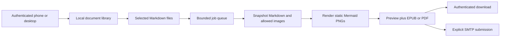

# Local Markdown publishing service

The user authorized the next implementation: a phone-first local picker and
preview, bounded conversion jobs, EPUB/PDF downloads, and configurable Send to
Kindle SMTP. Preserve the already verified Windows setup/lifecycle/reset flow.
Reading is primary; Kindle-side handwriting is optional and remains device-tested
behavior. Markdown sources are read-only, and actual delivery must not be inferred
from conversion or SMTP acceptance.

## Approach

Use a small TypeScript HTTP service and plain browser UI with the proven Pandoc,
Mermaid CLI rendering API, and Puppeteer engines. Build with TypeScript; no React,
database, cloud service, or additional publishing engine is needed. Python/Java
would add another application runtime without replacing the Node-based renderer.
Keep the original disposable proof runnable for comparison, but implement the
service converter with explicit resource boundaries and per-job publication.

## Library and conversion

- Browse one directory at a time, return relative IDs and names rather than host
  paths. Resolve the source root canonically (allow its cloud reparse point), and
  refuse selected files/resources escaping it through traversal or nested links.
- One selected Markdown file produces one job/document. EPUB is default; PDF is
  an alternative. A rendered self-contained HTML preview accompanies either.
- Parse GFM/YAML with Pandoc into an AST. Disable raw HTML, source-provided filters
  and executable document features. Transform real Mermaid blocks, not literal
  nested fences. Allow local PNG/JPEG/GIF/WebP with signature checks. Reject SVG,
  remote images, and active link schemes with clear errors.
- Copy referenced assets into the job's isolated working directory. Record hashes
  and verify originals have not changed during conversion; publish artifacts only
  on successful completion. Source changes fail the job instead of mixing versions.
- Bound Markdown/asset bytes, diagram count, queue size, conversion time, and
  request sizes. Run one conversion subprocess at a time. Cancellation terminates
  only the process tree owned by that job. No automatic resend or publish watcher.
- Isolate Mermaid/browser requests from external hosts and arbitrary local files.
  Source Mermaid cannot override renderer security/config or fetch remote assets.
- Keep generated jobs until explicit reset/deletion. Persist job records and
  recover interrupted jobs as interrupted, without automatically sending mail.

## HTTP, UI, and delivery

- Bind `127.0.0.1:8787` by default; configurable LAN binding is explicit. Generate
  a local access token in ignored state, never logs. Token login creates an
  HttpOnly SameSite cookie; bearer auth supports tools/tests. Check Host/Origin
  and JSON mutation requests, and keep previews in a script-disabled sandbox.
- Mobile UI includes login, folder breadcrumbs, filename filter, multi-selection,
  format selection, per-file progress/errors, rendered preview, download, cancel,
  and send. Show email availability and submission state honestly.
- SMTP is disabled by default. Configure server, TLS mode, sender, fixed Kindle
  recipient, optional auth user, and password environment-variable name. Do not
  accept recipients or SMTP credentials from browser requests.
- Require TLS except explicitly configured loopback-only development SMTP. Enforce
  a conservative attachment cap and disable Nodemailer file/URL fetching. Duplicate
  submit clicks must not send twice. Call success "submitted", never "delivered".
  After interruption or ambiguous SMTP failure, require explicit review/retry.

## Configuration and host operations

Extend schema version 1 with defaulted server/SMTP settings, preserving existing
local values. Update config example, configure/doctor, bootstrap/build, start,
stop, status, tests and reset instructions together. `start` now starts the HTTP
service; retain explicit proof mode for regression/lifecycle tests and old samples.
Service readiness is published only after the HTTP socket is listening. Stop
requests graceful shutdown first, with bounded owned-tree termination fallback.
Keep token values out of status/config output, URLs sent to the server, and logs.

## Validation and remaining limits

Use synthetic folders and local SMTP fixtures for tests, never private iCloud
content or actual Amazon email. Exercise traversal/junctions, hostile resources,
changed inputs, duplicate filenames, auth/origin, queue bounds, cancellation,
restart recovery, SMTP MIME/duplicate submission, and browser UI at phone width.
Run all original tests as well as build/typecheck and the new service tests.

Windows is the verified target. macOS execution and actual Scribe delivery,
reading comfort, and handwriting remain unverified until tested on those systems.
LAN HTTP is for a trusted local network; remote exposure requires external TLS.
