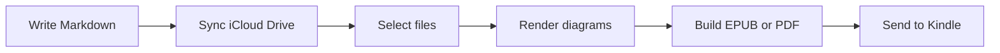
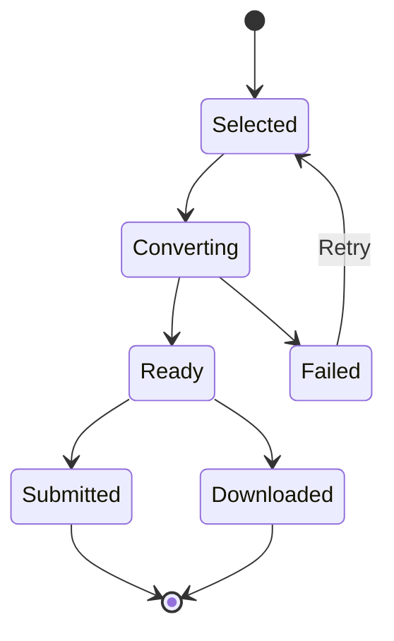
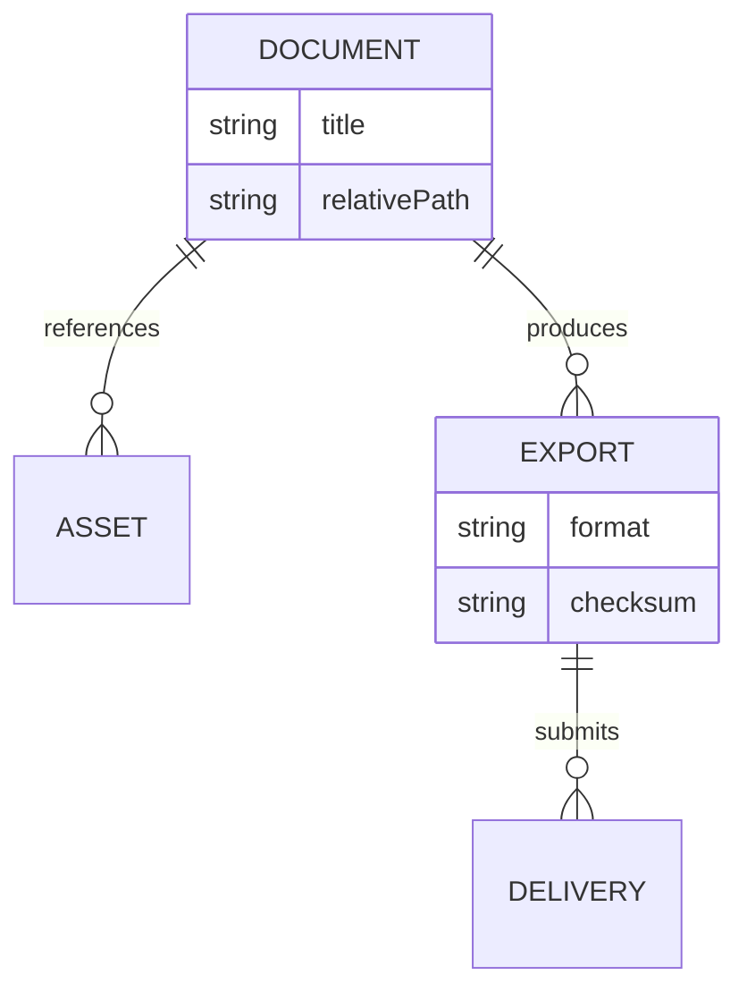
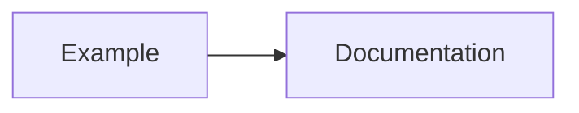

# A diagram compatibility check

This sample checks several diagram families and a deliberately wide layout.
Wide diagrams retain all their content, but their labels may need zooming on a
fixed-width display. Automatic layout cannot make every diagram readable at once.

## Wide flowchart



## State transitions



## Structured data



## A nested fence must remain source code

The following is an example *about* Mermaid. It must stay literal text, rather
than being converted into a sixth diagram.

````markdown

````

## Another kind of code

```python
def delivery_status(smtp_accepted: bool) -> str:
    # SMTP acceptance does not prove that Amazon delivered it.
    return "submitted" if smtp_accepted else "failed"
```
