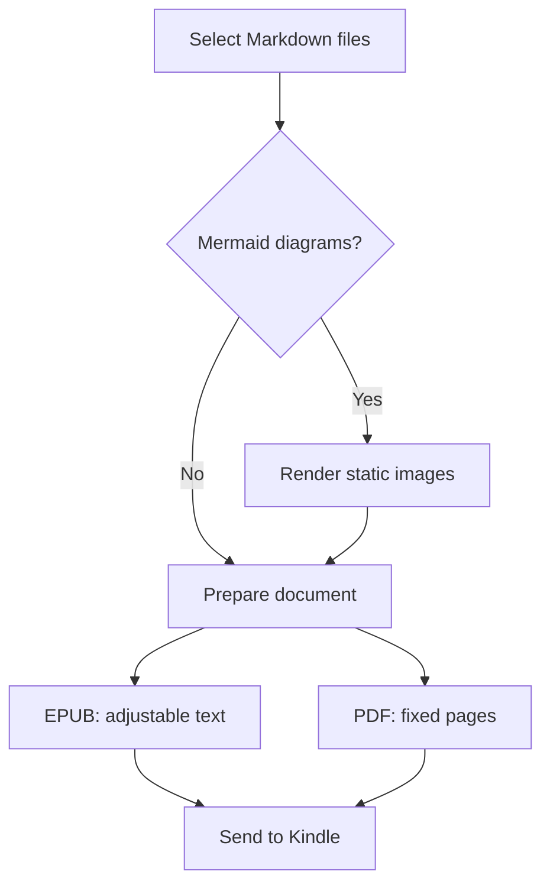
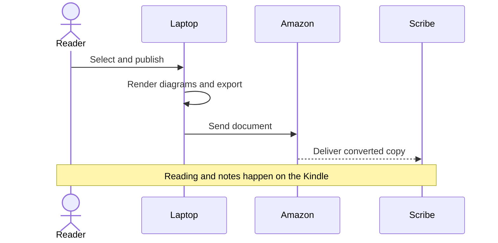

# A reading-first workflow

This sample checks how ordinary Markdown looks after conversion. Read it on
your Scribe at a comfortable text size, then compare the EPUB and PDF versions.
The original Markdown stays on the laptop; the Kindle receives a published copy.

## Select, convert, read

1. Select one or more Markdown files from a locally synced folder.
2. Render any Mermaid diagrams as images.
3. Choose EPUB for adjustable text or PDF for fixed pages and handwritten markup.
4. Send the exported document through Amazon's Send to Kindle service.



## Reading and annotation

| Format | Main advantage | What to check on the Scribe |
|:-------|:---------------|:----------------------------|
| EPUB | Adjustable text size | Comfortable reading and legible diagrams |
| PDF | Stable layout | Direct pen markup after Send to Kindle import |

**Important:** this proof does not send mail or synchronize notes back into
Markdown. It creates local files for you to inspect and send yourself.

## Local images

The illustration below is a local PNG. Its filename contains a space, so it
also checks relative asset resolution and embedding into a portable document.


## Code and technical text

```typescript
const files = ["notes.md", "architecture.md"];
for (const file of files) {
  await publish(file, { format: "epub" });
}
```

Text should remain selectable in the PDF. Links such as
[Amazon Send to Kindle](https://www.amazon.com/sendtokindle) should remain links.
Characters to check include café, naïve, résumé, £, €, and Greek α, β, γ.

## A conversation between components



## What a successful result looks like

- No Mermaid source code appears where a diagram should be.
- Both diagrams and the local chart appear without internet access.
- Table columns and code fit on the PDF page.
- PDF page margins leave room for a few handwritten marks.
- EPUB headings appear in the table of contents.

This is a synthetic conversion fixture, not an assurance of Amazon delivery or
physical-device readability. Those need a real Send to Kindle import and a look
at the Scribe screen.
